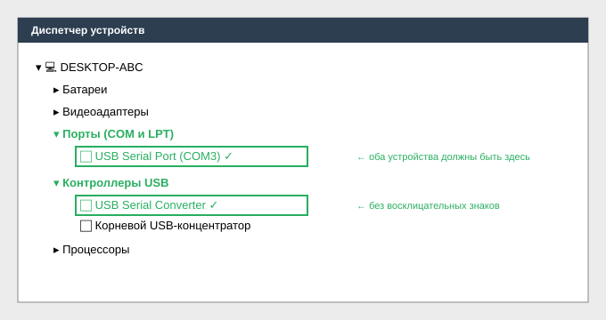

# 01. Установка TechStream и драйверов MINI VCI

**Время выполнения:** 15–20 минут
**Требуется:** ноутбук с Windows, кабель MINI VCI, права администратора.

> ⚠️ Отключайте антивирус на время установки — он часто блокирует патч лицензии и драйверы FTDI.

---

## Шаг 1. Распакуйте дистрибутив

Скачайте архив с TechStream (версия 8.x — универсальная, 16.x–18.x — для свежих моделей) и распакуйте в папку без кириллицы, например `C:\TIS`.

## Шаг 2. Установите драйвер MINI VCI

1. Откройте папку `MVCI Driver for TOYOTA.msi`.
2. Запустите установщик **от имени администратора** (ПКМ → *Запуск от имени администратора*).
3. Нажимайте **Next**, оставляя пути по умолчанию.
4. В конце откажитесь от перезагрузки (**No**).

## Шаг 3. Установите TechStream

1. Запустите `Setup.exe` из папки TechStream.
2. Примите лицензионное соглашение.
3. **Region:** выберите *Europe* (для РФ/СНГ) или *General*.
4. Дождитесь окончания установки.

## Шаг 4. Активируйте программу

1. Запустите TechStream один раз — он покажет окно активации или просто закроется.
2. Скопируйте файл-патч `MainMenu.exe` (из папки `patch`) в `C:\Program Files (x86)\Toyota Diagnostics\Techstream\bin\` **с заменой**.
3. При запросе лицензионного ключа введите значение из `activation.txt`.

## Шаг 5. Проверка драйвера кабеля

1. Подключите MINI VCI к USB.
2. Откройте **Диспетчер устройств** (`Win + X` → *Диспетчер устройств*).
3. В разделе **Порты (COM и LPT)** должны появиться:
   - `USB Serial Port (COMx)`
   - `Universal Serial Bus Controllers → USB Serial Converter`

Если устройство не определилось — доустановите драйвер **FTDI VCP** (`CDM212364_Setup.exe` из комплекта).

## Шаг 6. Проверка связи с кабелем

Пуск → **Toyota Diagnostics** → **TIS Techstream** → в правом верхнем углу должна быть надпись *VIM Status: VIM OK*.

---

## Возможные проблемы

| Симптом | Решение |
|---------|---------|
| «VIM not detected» | Проверьте COM-порт в Диспетчере, переустановите FTDI VCP |
| «Error: HASP not found» | Повторно примените патч, запустите от имени администратора |
| Крашится при запуске | Установите Microsoft Visual C++ 2010 Redistributable (x86) |

## Источники со скриншотами

- [Drive2 — «Установка Techstream на Windows 7, 8.1, 10 — x64 bit»](https://www.drive2.ru/b/479152325051547873/) — пошагово с живыми скриншотами, обходной путь через `msiexec /a` для 64-битной Windows.
- [PriusChat — Techstream inconsistencies](https://priuschat.com/goto/post?id=2444747) — частые проблемы с драйверами FTDI и COM-портом.
- [RTS Auto PDF — MVCI Driver ended prematurely](https://www.rtsauto.com/wp-content/uploads/2019/10/MVCI-Driver-ended-prematurely-error.pdf) — разбор ошибки инсталлятора с иллюстрациями.
- [newhilux.net — Techstream + mini-VCI HOW-TO](https://www.newhilux.net/phpbb/viewtopic.php?p=289699) — англоязычный гайд с подробными скриншотами.

**Следующий шаг:** [02. Первое подключение к автомобилю →](02-connect-to-vehicle.md)
