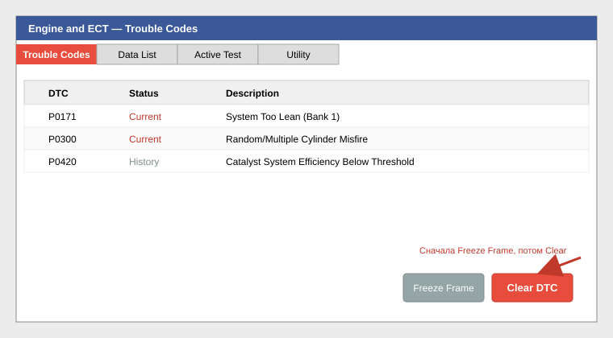

# 03. Чтение и сброс кодов неисправностей (DTC)

**Время выполнения:** 2–5 минут.
**Применяется:** при горящем «check engine», для проверки истории неисправностей, после ремонта.

---

## Шаг 1. Подключитесь к автомобилю

Выполните шаги 1–4 из [инструкции 02](02-connect-to-vehicle.md). Зажигание — **IG-ON**, двигатель можно не запускать.

## Шаг 2. Выберите систему

В окне **System Select** нажмите нужный раздел, например **Engine and ECT** (двигатель и АКПП).

## Шаг 3. Откройте список ошибок

В меню слева выберите вкладку **Trouble Codes** (иногда — *DTC*).

Программа покажет таблицу:

| Столбец | Значение |
|---------|----------|
| **DTC** | Код ошибки (например, `P0171`) |
| **Status** | *Current* — активна, *History / Pending* — в памяти |
| **Description** | Расшифровка |

## Шаг 4. Сохраните снимок данных

Перед сбросом **обязательно** сохраните Freeze Frame (мгновенные параметры в момент ошибки):

1. Выделите нужный код.
2. Нажмите кнопку **Freeze Frame Data** внизу окна.
3. **File → Save Snapshot** в формате `.ssm`.

## Шаг 5. Сброс кодов

1. Нажмите кнопку **Clear DTC** (внизу справа).
2. Подтвердите **Yes** в диалоговом окне.
3. Дождитесь сообщения *«DTC clear completed»*.
4. Нажмите **Refresh** (F5) — чтобы убедиться, что активных кодов не осталось.

> ⚠️ Если код тут же появляется снова — неисправность активна, одним сбросом не лечится. Переходите к диагностике по Live Data.

## Шаг 6. Проверка Live Data

В той же системе откройте вкладку **Data List** и запустите чтение параметров (**Start**). Полезные параметры для двигателя:

- Short/Long Fuel Trim (STFT/LTFT) — ±10% норма.
- MAF g/s — массовый расход воздуха.
- Coolant Temp — температура ОЖ.
- Idle Speed — обороты ХХ.

Можно построить графики: выделите параметр галочкой → **Line Graph**.

---

## Распространённые коды Toyota

| Код | Что обычно означает |
|-----|---------------------|
| P0171/P0174 | Бедная смесь — подсос воздуха, грязный MAF |
| P0300–P0304 | Пропуски зажигания в цилиндре |
| P0420 | Низкая эффективность катализатора |
| C1201 | Неисправность ABS/VSC — читайте в разделе Chassis |
| B1421 | SRS — проверьте разъёмы под сиденьями |

**Следующий шаг:** [04. Сброс адаптации АКПП →](04-reset-at-adaptation.md)
