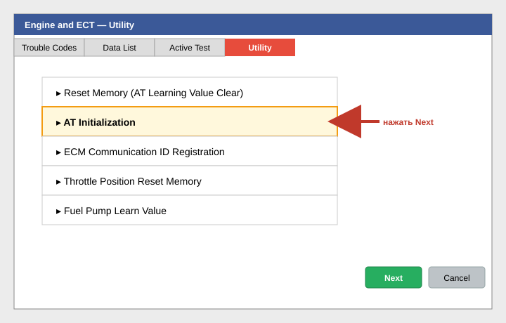
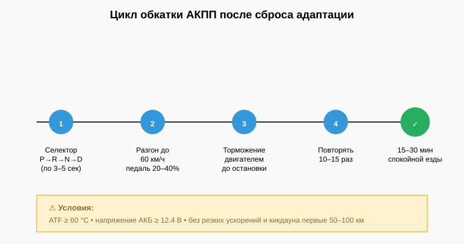

# 04. Сброс адаптации АКПП

**Применяется:** после замены масла в АКПП, при появлении рывков/пинков, задержек при переключениях, после ремонта гидроблока.
**Время выполнения:** 5 минут диагностики + 15–30 минут обкатки.

> ⚠️ **Условия обязательны.** Нарушение приведёт к неполному сбросу или новой некорректной адаптации.
> - Температура масла АКПП **не ниже 60 °C** (лучше 70–85 °C).
> - Автомобиль стоит на ровной поверхности, селектор в **P**, стояночный тормоз включён.
> - Напряжение АКБ **не ниже 12.4 В**.
> - Двигатель запущен и работает на холостых.

---

## Шаг 1. Подключитесь и выберите АКПП

1. [Подключитесь к автомобилю](02-connect-to-vehicle.md).
2. Запустите двигатель и прогрейте АКПП (10–15 мин езды в разных режимах).
3. В **System Select** выберите **ECT** / **Transmission** / **Engine and ECT** (зависит от модели).

## Шаг 2. Проверьте температуру АКПП

Откройте **Data List**, найдите параметр **ATF Temperature** (или *AT Oil Temp*).

Убедитесь, что значение **≥ 60 °C**. Если ниже — поездите ещё 5–10 минут.

## Шаг 3. Откройте раздел сброса

Перейдите на вкладку **Utility** (внизу слева).

Доступные пункты зависят от модели. Выберите один из:

- **Reset Memory** (чаще всего).
- **AT Initialization**.
- **ECT Reset**.

## Шаг 4. Выполните сброс

1. Нажмите на выбранный пункт.
2. Прочитайте условия в появившемся окне (двигатель заведён, селектор P, педали отпущены).
3. Нажмите **Next**.
4. Дождитесь сообщения *«Reset Memory completed»*.

## Шаг 5. Переобучение (адаптация)

Выключите зажигание на **10 секунд**, затем:

1. Запустите двигатель.
2. С выжатым тормозом переведите селектор: **P → R → N → D → N → R → P**, задерживаясь по 3–5 сек в каждом положении.
3. Поезжайте в спокойном режиме **15–30 минут**:
   - Разгоны до 60 км/ч с умеренным нажатием педали (20–40%).
   - Торможения двигателем до остановки.
   - Несколько полных остановок с переключением D ↔ R на ровной площадке.
4. Избегайте резких ускорений и кикдауна первые 50–100 км.

## Шаг 6. Проверка результата

После обкатки подключитесь ещё раз:

- **Data List → AT Learn Value / Shift Pattern** — значения должны стать близкими к нулю (значит, адаптация записалась с нуля).
- **Trouble Codes** — не должно быть новых ошибок.

---

## Если рывки не ушли

1. Проверьте уровень и состояние ATF (цвет, запах).
2. Считайте DTC в разделе **ECT** (коды P07xx, P08xx).
3. Проверьте давление в линии через **Active Test → Line Pressure** (если доступно).
4. Если АКПП прошла значительный пробег (200+ тыс. км) — сброс может «обострить» износ соленоидов. Это диагностический признак, а не поломка.

**Следующий шаг:** [05. Инициализация дроссельной заслонки →](05-throttle-body-init.md)
