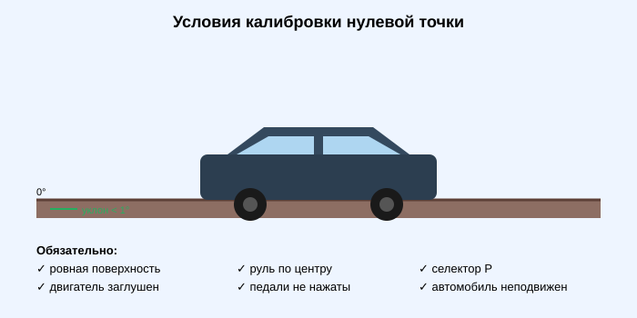
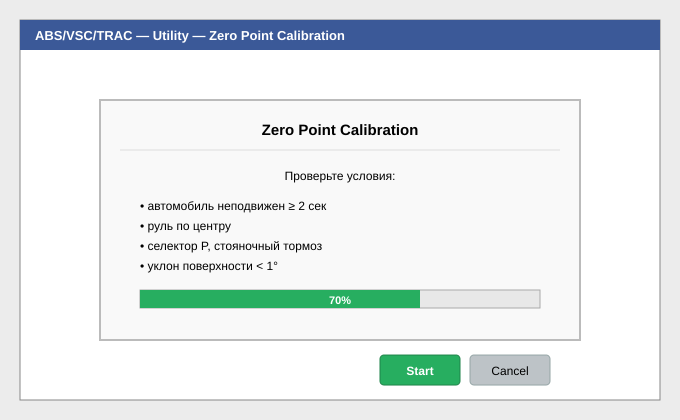

# 06. Калибровка нулевой точки датчиков (Yaw / G / Steering Angle)

**Применяется:** после ремонта подвески, развал-схождения, замены датчиков YAW/G, снятия ABS/VSC, замены рулевой рейки.
**Время выполнения:** 10 минут.

---

## Условия выполнения

Нарушение любого из пунктов приведёт к некорректной калибровке — датчики запомнят **кривой ноль**, и VSC/TRAC будут срабатывать ложно.

- Автомобиль стоит на **ровной** поверхности (уклон менее 1°).
- Руль — строго в **центральном положении**.
- Селектор — в положении **P** (МКПП — нейтраль + стояночный тормоз).
- Двигатель **заглушен** (на части моделей — заведён; см. подсказки TechStream).
- Автомобиль **полностью неподвижен**, никто внутри не двигается.
- Педали **не нажаты**.

---

## Шаг 1. Подключение

1. [Подключитесь к автомобилю](02-connect-to-vehicle.md).
2. Зажигание — **IG-ON**, двигатель заглушен.

## Шаг 2. Выбор системы

**System Select** → **Chassis** → **ABS/VSC/TRAC**.

## Шаг 3. Очистка старых значений

1. Вкладка **Utility** → **Reset Memory**.
2. Прочтите предупреждение, нажмите **Next**.
3. Дождитесь *«Reset Memory completed»*.

Этот шаг обязателен: без очистки датчики нельзя откалибровать повторно.

## Шаг 4. Вход в тестовый режим

В том же **Utility** → **Test Mode**.

Программа предупредит, что система переходит в тестовый режим. Нажмите **Next**.

## Шаг 5. Выполнение калибровки

1. Убедитесь, что все условия выше соблюдены — автомобиль неподвижен **не менее 2 секунд**.
2. В меню выберите **Zero Point Calibration** (или *Yaw Rate / Acceleration Sensor Zero Point Calibration*).
3. Нажмите **Next** → **Start**.
4. Дождитесь сообщения *«Calibration completed»*.

> 💡 Калибровка выполняется **только один раз** после входа в Test Mode. Чтобы повторить — снова выполните Reset Memory.

## Шаг 6. Выход из Test Mode

1. **Utility** → **Exit Test Mode** (или просто завершите сессию и выключите зажигание на 10 сек).
2. Запустите двигатель.
3. Убедитесь, что лампы **ABS**, **VSC**, **TRAC OFF** на панели **погасли**.

## Шаг 7. Калибровка угла руля (при наличии VGRS)

Для автомобилей с VGRS (Lexus LX/LS, Toyota Land Cruiser 200, GX и др.) после калибровки нулевой точки:

1. Проедьте по **прямой ровной дороге** со скоростью от 35 км/ч **не менее 5 секунд**.
2. Повторите в обратную сторону.
3. Проверьте в **Data List → Steering Angle** — значение на прямой должно быть близко к **0°**.

---

## Частые ошибки

| Симптом | Причина |
|---------|---------|
| *Calibration failed* | Автомобиль покачивался (ветер, хлопнула дверь), не выполнен Reset Memory |
| Горит VSC после калибровки | Не вышли из Test Mode / значения не сохранились |
| Руль «ушёл» на 1–2 градуса | Калибровку делали с не точно выставленным рулём |

## Источники со скриншотами

- [vehicleservicepros.com — Toyota zero point calibration (TSB 2014)](https://www.vehicleservicepros.com/tsbs/article/53092346/toyota-zero-point-calibration-2014-10-06) — переопубликованный Toyota TSB со скриншотами меню TechStream.
- [ClubLexus — Zero point calibration via Techstream](https://www.clublexus.com/forums/ls-3rd-gen-2001-2006/789241-how-to-do-a-zero-point-calibration-via-techstream.html) — пошагово с живыми скриншотами Utility → Test Mode.
- [PriusChat PDF — Prius SM Yaw Rate Zero Point](https://attachments.priuschat.com/attachment-files/2024/05/250911_Prius_SM_-_Yaw_Rate_and_Acceleration_Zero_Point.pdf) — страницы сервисного мануала Prius со схемами.
- [NHTSA TSB MC-10109460-9999 (PDF)](https://static.nhtsa.gov/odi/tsbs/2014/MC-10109460-9999.pdf) — инициализация VGRS: поездка по прямой ≥35 км/ч ≥5 секунд.

**Следующий шаг:** [07. Прокачка тормозов через Active Test (ABS) →](07-abs-bleeding.md)
